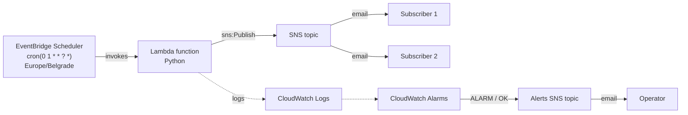

# Daily "Hello, world!" Email: AWS Lambda + SNS + EventBridge Scheduler

A small serverless pipeline that emails **"Hello, world!"** once a day at **01:00** (Europe/Belgrade). A scheduled AWS Lambda function publishes the message to an Amazon SNS topic, and SNS delivers it to every confirmed email subscriber. The whole stack is defined in Terraform.

## Architecture



| Component | AWS service | Responsibility |
|---|---|---|
| Schedule | EventBridge Scheduler | Fires once a day at 01:00 in the configured time zone |
| Function | Lambda (Python) | Publishes the message to the SNS topic |
| Topic | SNS (Standard) | Fans the message out to subscribers |
| Subscriptions | SNS email subscriptions | Deliver the message; each recipient must confirm |
| Function role | IAM | Lets the function write logs and publish to **this one topic** |
| Scheduler role | IAM | Lets the Scheduler invoke **this one function** |
| Logs | CloudWatch Logs | Function output, 14-day retention |
| Alarms | CloudWatch Alarms + a separate SNS topic | Email the operator if the function fails or stops running |

## Repository layout

```
.
|-- main.tf             # SNS, IAM, Lambda, log group, schedule, alarms
|-- variables.tf        # Variables for admins/users input.
|-- outputs.tf          # Useful output for admins/users
|-- lambda_function.py  # The Lambda source
|-- README.md
```

## Lambda function

```python
import os

import boto3

# Created outside the handler so warm invocations reuse the client.
sns = boto3.client("sns")


def lambda_handler(event, context):
    response = sns.publish(
        TopicArn=os.environ["TOPIC_ARN"],
        Subject="Daily message",
        Message="Hello, world!",
    )
    return {"messageId": response["MessageId"]}
```

| Setting | Value | Notes |
|---------|-------|-------|
| Runtime | `python3.14` | `boto3` is included in the Lambda Python runtime, so nothing is packaged with it |
| Handler | `lambda_function.lambda_handler` | `<file name without .py>.<function name>` |
| Timeout | 5 seconds | The default is 3 |
| Environment | `TOPIC_ARN` | Set by Terraform from the topic resource |
| Input event | ignored | The schedule sends `{}` |

Design notes:

- **The SNS client is created outside the handler.** It runs once per cold start and is reused by warm invocations.

## Permissions (least privilege)

Two roles, each with a trust policy (who may use the role) and a permissions policy (what it may do):

| Role | Trusted service | Permissions |
|---|---|---|
| Lambda execution role | `lambda.amazonaws.com` | `AWSLambdaBasicExecutionRole` (write logs) and `sns:Publish` on the one topic ARN |
| Scheduler role | `scheduler.amazonaws.com` | `lambda:InvokeFunction` on the one function ARN |

Nothing uses `Resource: "*"`.

## Prerequisites

- [Terraform](https://developer.hashicorp.com/terraform/install) 1.5 or newer
- An AWS account and credentials that can create IAM roles, Lambda functions, SNS topics, EventBridge schedules and CloudWatch alarms (`aws configure` or SSO)
- An email address to receive the message

## Deploy

```bash
terraform init
terraform validate
terraform plan
terraform apply
```

Optionally subscribe addresses from Terraform:

```bash
terraform apply \
  -var='subscriber_emails=["you@example.com"]' \
  -var='alert_emails=["you@example.com"]'
```

Of subscribe by adding the desired emails directly to the [variables.tf](variables.tf) file under SUBSCRIBER_EMAILS and ALERT_EMAILS

**Every recipient must click the confirmation link AWS emails them.** Until then the subscription is *Pending* and receives nothing (as required in the assignment).

To subscribe without Terraform:

## Configuration

| Variable | Default | Purpose |
|---|---|---|
| `region` | `eu-west-1` | Region for **all** resources |
| `topic_name` | `hello-world-topic` | SNS topic name |
| `function_name` | `hello-world-function` | Lambda function name |
| `schedule_name` | `hello-world-daily` | EventBridge schedule name |
| `schedule_expression` | `cron(0 1 * * ? *)` | When to run |
| `schedule_timezone` | `Europe/Belgrade` | Time zone for the expression |
| `subscriber_emails` | `[]` | Emails subscribed to the main topic |
| `alert_emails` | `[]` | Emails subscribed to the alerts topic (`alarms.tf`) |

The cron fields are `minute hour day-of-month month day-of-week year`. One of the two day fields must be `?`.


## Monitoring

`alarms.tf` creates two alarms that publish to a **separate** alerts topic, so failure notices never reach the "Hello, world!" subscribers.

| Alarm | Metric | Triggers when | Missing data |
|---|---|---|---|
| `…-errors` | `AWS/Lambda` `Errors` | At least 1 error (exception or timeout) in a 5-minute window | `notBreaching`: no data means no errors |
| `…-not-running` | `AWS/Lambda` `Invocations` | No invocation in any of the last 24 hourly windows | `breaching`: silence is the failure |

The second alarm catches failures the first can't see. If the schedule or its permissions break, the function never starts, so no errors are recorded. It will likely fire shortly after the first deployment because there is no history yet, then clear after the first scheduled run.

## Design decisions

- **EventBridge Scheduler, not a classic EventBridge rule.** Scheduler supports an explicit time zone, so "01:00" stays 01:00 local time across daylight-saving changes. Classic rules run in UTC only.
- **A separate alerts topic.** Operators and end users get different messages.
- **An explicit log group.** Lambda would create one automatically, but without a retention limit logs would be kept forever.
- **Everything in Terraform.** The console steps were done by hand once, and the same setup can now be recreated, reviewed and destroyed from code.


## Cleanup

```bash
terraform destroy
```

Removes every resource Terraform created. Delete any resources you built by hand in the console separately, or they will keep running and sending duplicate emails.